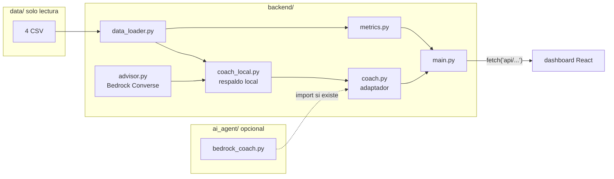

# NFL Front Office Tactical Copilot

Aplicación web de analítica para la NFL desarrollada en el Hackathon NFL Big Data Bowl (UNAM / AWS). Funciona como un "War Room" para el Front Office:

- **Cuadrante de eficiencia:** mide qué tan eficiente es cada equipo con y sin tiempo basura.
- **Comparador de matchups:** pone a dos equipos cara a cara.
- **Simulador de 4ta oportunidad:** recomienda una decisión con base en datos históricos.
- **Copiloto táctico:** responde preguntas con Amazon Bedrock (Nova).

La app funciona completa aunque la IA no esté disponible. En ese caso, el copiloto entrega una recomendación automática construida con los mismos datos.

## Stack

| Capa | Tecnología |
| --- | --- |
| Backend | Python 3.12, FastAPI, Uvicorn, Pydantic, pandas, numpy (`backend/`) |
| Frontend | React 18, Vite 5, TypeScript, Tailwind CSS 3, Recharts (`dashboard/`) |
| IA (opcional) | Amazon Bedrock, modelo Amazon Nova, vía boto3 |
| Pruebas | pytest, httpx (`TestClient`) |
| Desarrollo | Kiro (steering, specs y hooks en `.kiro/`) |

La app no usa S3, bases de datos ni otros servicios de AWS. El servidor lee `data/` en modo lectura al arrancar y calcula todo en memoria.

## Datos

Los datos combinan dos fuentes:

- **NFL Big Data Bowl 2023:** temporada 2021, semanas 1 a 8, solo jugadas de pase.
- **Play-by-play de nflverse 2021:** aporta `epa`, `wp`, `wpa`, `cpoe`, `air_yards` y `roof`, más los nombres y colores de los equipos.

Las jugadas se unen por `gameId = old_game_id` y `playId = play_id`.

| Archivo en `data/` | Filas | Uso |
| --- | --- | --- |
| `plays_clean.csv` | 8,034 jugadas (1,316 marcadas como tiempo basura) | Recálculo de métricas con y sin tiempo basura, y métricas complementarias |
| `team_efficiency.csv` | 32 equipos (2021) | Métricas principales sin tiempo basura |
| `teams_meta.csv` | 36 equipos (incluye abreviaturas históricas como OAK, SD, STL y LAR) | Nombre, conferencia, división y colores |
| `fourth_down_situations.csv` | 26 de las 30 combinaciones `ydstogo × field_zone` | Simulador de 4ta oportunidad |

**Tiempo basura:** jugadas con probabilidad de victoria (`wp`) fuera del rango 0.05–0.95, marcadas en la columna `garbage_time`.

### Métricas

Todas se calculan sobre `plays_clean.csv`. Al recalcular sin tiempo basura, los valores coinciden con `team_efficiency.csv` con un error máximo de 5e-5.

| Métrica | Fórmula |
| --- | --- |
| `plays` | jugadas por `posteam` |
| `epa_per_play` / `def_epa_per_play` | media de `epa` por `posteam` / `defteam` (en defensa, menor es mejor) |
| `success_rate` / `def_success_rate` | proporción de jugadas con `epa > 0` |
| `pass_epa`, `run_epa` | media de `epa` en pases / carreras (las carreras son solo del QB) |
| `cpoe` | media de `cpoe` en pases, sin contar los vacíos |
| `early_down_pass_rate` | proporción de pases en 1er y 2do down |
| `yards_per_play` | media de `yards_gained` |
| `completion_pct` | completos / (completos + incompletos + intercepciones) |
| `sack_rate` | capturas / jugadas |

## Arquitectura



- **Arranque:** `main.py` ejecuta `cargar_env()` como primera instrucción y después importa el resto. Todo el cálculo de datos ocurre en el `lifespan` de FastAPI, y ningún módulo escribe en disco.
- **Servidor único:** FastAPI sirve la API bajo `/api/...` y el build del dashboard (`dashboard/dist`) en el mismo puerto.
- **Rutas del dashboard:** llama a la API con rutas relativas (`fetch('api/...')`, sin diagonal inicial). Así funciona aunque la app se publique en una subruta.
- **IA:** solo se invoca desde `POST /api/coach/ask`, cuando el usuario presiona el botón del copiloto.

### Módulos del backend

| Archivo | Responsabilidad |
| --- | --- |
| `main.py` | `cargar_env()`, aplicación FastAPI, rutas y archivos estáticos |
| `data_loader.py` | Lectura y validación de los CSV (`DataStore`). Usa datos simulados si falta un archivo. |
| `metrics.py` | Funciones puras: métricas por equipo, matchup, zona del campo y simulación de 4ta oportunidad |
| `coach.py` | Adaptador: usa `ai_agent/bedrock_coach.py` si existe; si no, o si falla, usa el respaldo local. También convierte las respuestas a JSON seguro y aplica un límite de tiempo. |
| `coach_local.py` | `LocalCoach`: las mismas cuatro funciones del copiloto, calculadas con el `DataStore` |
| `advisor.py` | Llamada a Bedrock Converse con boto3 y texto automático de respaldo |
| `schemas.py` | Modelos Pydantic de las peticiones y respuestas |

## API

| Método y ruta | Descripción |
| --- | --- |
| `GET /health` | `{"status": "ok"}` |
| `GET /api/meta` | Temporadas, equipos (nombre y colores), avisos de datos simulados y origen del copiloto (`ai_agent` o `backend`) |
| `GET /api/efficiency?season&exclude_garbage_time` | Métricas de los 32 equipos para el cuadrante |
| `GET /api/matchup?home&away&season&exclude_garbage_time` | Comparación de dos equipos con rankings (`*_rank`, 1 = mejor) y contexto para el copiloto |
| `POST /api/fourth-down/simulate` | `{ydstogo, yardline_100}` → recomendación, opciones, advertencias y contexto |
| `POST /api/coach/ask` | `{question, topic, ...}` → `{text, ai_generated, source}` |

En `/api/coach/ask`, el servidor reconstruye el contexto según el tema:

- `topic = "matchup"` requiere `home` y `away`, y deben ser distintos.
- `topic = "fourth_down"` requiere `ydstogo` y `yardline_100`.

### Errores

| Situación | Respuesta |
| --- | --- |
| Parámetros inválidos o faltantes | 422 |
| Equipo inexistente en un matchup | 404 con el mensaje |
| Copiloto con error, respuesta vacía o más de 30 s | 200, con el texto automático y `ai_generated: false` |
| `ai_agent/` ausente o con error al importar | La app funciona con el respaldo local (`coach_source = "backend"`) |
| CSV ausente o sin columnas | Datos simulados y aviso en el dashboard |

## Dashboard

- **Cuadrante de eficiencia:** gráfica de dispersión de `epa_per_play` (ofensiva) contra `def_epa_per_play` (defensiva), con un punto por equipo en su color oficial. Tiene un interruptor para incluir o excluir el tiempo basura. Las métricas complementarias (`yards_per_play`, `completion_pct`, `sack_rate`) aparecen en el detalle.
- **Comparador de matchups:** se eligen el equipo A y el equipo B. Muestra métricas EPA y de yardas, con el lugar de cada equipo en la liga (`#n`).
- **Simulador de 4ta oportunidad:** se capturan `ydstogo` y `yardline_100`. Muestra:
  - La recomendación y la regla que la produjo.
  - La tabla de opciones: jugársela con EPA y probabilidad de conversión; gol de campo y despeje como "Sin datos".
  - Las advertencias y una gráfica por zona del campo.
- **Copiloto táctico:** aparece dentro del comparador y del simulador.
  - Tiene una caja de pregunta editable (máximo 500 caracteres) y el botón "Consultar al copiloto".
  - Cada respuesta se etiqueta como "Generado por IA" o "Recomendación automática (sin IA)".
  - La respuesta se borra al cambiar los parámetros.
- **Encabezado:** indica si el contexto viene de `ai_agent` o del respaldo local.

### Regla de 4ta oportunidad

1. **Jugársela (Go For It)** si `conversion_prob >= 0.50` y hay al menos 5 jugadas históricas (`sample_size >= 5`).
2. Si no, **gol de campo** cuando `yardline_100 <= 37`, que equivale a una patada de unas 54–55 yardas.
3. En cualquier otro caso, **despeje (punt)**.

Siempre se muestran el tamaño de la muestra y las advertencias.

## Copiloto con Amazon Bedrock

- **Llamada:** usa la API Converse de Bedrock. El modelo sale de `BEDROCK_MODEL_ID` (default `us.amazon.nova-pro-v1:0`) y la región de `AWS_REGION` (default `us-east-1`). El cliente se crea solo con la región.
- **Credenciales:** el código no las lee ni las valida. En local, boto3 las toma del `.env`. En AWS las da el rol de la tarea.
- **Prompt de sistema:** pide responder en español, en 3 a 6 frases y usando solo los datos del contexto.
- **Respaldo:** si Bedrock falla, tarda más de 30 s o responde vacío, la app muestra un resumen automático sin hacer una segunda llamada.

## Cómo correrlo en local

### Requisitos

- Python 3.12 con el entorno `.venv` de la plantilla
- Node 22 y npm

### 1. Credenciales (opcional, solo para la IA)

Copia la plantilla y llena las llaves temporales del workshop:

```powershell
Copy-Item .env.example .env
```

```env
AWS_ACCESS_KEY_ID=
AWS_SECRET_ACCESS_KEY=
AWS_SESSION_TOKEN=
```

El archivo `.env` no se versiona ni se incluye en la entrega. Sin él, la app funciona con el respaldo automático.

### 2. Backend (puerto 8000)

```powershell
.\.venv\Scripts\python.exe -m uvicorn backend.main:app --reload --port 8000
```

### 3. Dashboard en modo desarrollo

```powershell
cd dashboard
npm install
npm run dev
```

Vite redirige `/api` a `http://localhost:8000` (proxy en `vite.config.ts`, con `base: './'`).

### 4. Build de producción

```powershell
cd dashboard
npm run build
```

Con `dashboard/dist` generado, FastAPI sirve el dashboard y la API en el mismo puerto.

## Pruebas

```powershell
.\.venv\Scripts\python.exe -m pytest -q
```

Ninguna prueba llama a AWS: Bedrock y el módulo externo se simulan.

| Propiedad | Qué se verifica |
| --- | --- |
| Ida y vuelta JSON | Todas las filas de equipos se serializan sin pérdida |
| Consistencia | El recálculo coincide con `team_efficiency.csv` (tolerancia 1e-4) |
| Filtro | La diferencia de jugadas con y sin tiempo basura suma 1,316 |
| Simetría | Los 32 × 31 matchups son simétricos |
| 4ta oportunidad | La regla se cumple en todas las combinaciones de `ydstogo` (1–30) y `yardline_100` (1–99) |
| Adaptador | Ante errores del módulo externo se usa el respaldo; `ValueError` produce 404 |
| Límite de tiempo | Un copiloto que tarda más del límite devuelve el respaldo con `ai_generated: false` |
| Sin llamadas automáticas | Solo `/api/coach/ask` llama a Bedrock |
| JSON seguro | Valores de numpy, `NaN` y DataFrames se convierten a JSON válido |

Para el dashboard: `tsc --noEmit`, `vite build`, y revisar que en `dashboard/src` no haya `'/api`, `localhost`, `127.0.0.1` ni URLs absolutas.

## Entrega

```powershell
.\.hackathon\setup.cmd --check      # verifica el entorno
.\.hackathon\setup.cmd --entregar   # genera el .zip de entrega
```

En macOS o Linux: `sh .hackathon/setup.sh --check` y `sh .hackathon/setup.sh --entregar`.

## Limitaciones

- **Solo jugadas de pase.**
  - No hay goles de campo ni despejes, por eso esas opciones del simulador aparecen como "Sin datos".
  - `run_epa` solo refleja carreras del QB.
  - `early_down_pass_rate` sale cerca de 100% para todos los equipos.
- **Muestra limitada.** Son 8 semanas de 2021, y varias situaciones de 4ta oportunidad tienen menos de 5 jugadas. Las advertencias del simulador lo indican.
- **Logos:** no se muestran, porque son URLs externas. Se usan nombres y colores oficiales.

## Equipo

| Rol | Responsabilidad |
| --- | --- |
| Persona A: Data & AI | Limpieza y unión de datos (Big Data Bowl + nflverse), métricas y módulo del copiloto (`ai_agent/`) |
| Persona B: Product & UI | Specs y hooks en Kiro, API en FastAPI, dashboard en React y pitch |

## Créditos

- Tracking: NFL Next Gen Stats. Scouting: Pro Football Focus (NFL Big Data Bowl 2023).
- Play-by-play y metadatos de equipos: [nflverse](https://github.com/nflverse), licencia CC-BY 4.0.
